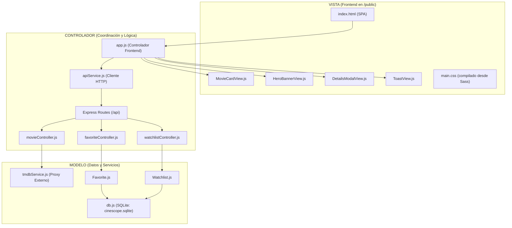

# CineScope 🎬 — Plataforma Full-Stack de Descubrimiento Cinematográfico


> **Proyecto Universitario de Ingeniería de Software**  
> Demostración de arquitectura Full-Stack real, patrón de diseño Modelo-Vista-Controlador (MVC), persistencia en base de datos SQLite, consumo seguro de API externa (The Movie Database - TMDB), diseño responsivo con Bootstrap 5 y personalización modular con Sass.

---

## 📋 Tabla de Contenidos

1. [Descripción del Proyecto](#-descripción-del-proyecto)
2. [Identidad Visual y Diseño UI/UX](#-identidad-visual-y-diseño-uiux)
3. [Tecnologías Utilizadas](#-tecnologías-utilizadas)
4. [Arquitectura del Software (Patrón MVC)](#-arquitectura-del-software-patrón-mvc)
5. [Estructura del Proyecto](#-estructura-del-proyecto)
6. [Flujo de Comunicación (Frontend ↔ Backend ↔ TMDB)](#-flujo-de-comunicación)
7. [Instalación y Puesta en Marcha](#-instalación-y-puesta-en-marcha)
8. [Configuración de Credenciales TMDB](#-configuración-de-credenciales-tmdb)
9. [Documentación de la API REST Propia](#-documentación-de-la-api-rest-propia)
10. [Seguridad y Buenas Prácticas](#-seguridad-y-buenas-prácticas)
11. [Atribución Oficial a TMDB](#-atribución-oficial-a-tmdb)

---

## 🎯 Descripción del Proyecto

**CineScope** es una aplicación web Full-Stack moderna para amantes del cine que permite:
- **Explorar películas en tiempo real:** Películas populares, en tendencia y próximos estrenos consultados directamente desde los servidores de TMDB.
- **Filtrado y ordenamiento dinámico:** Filtros por géneros cinematográficos oficiales y ordenamiento por popularidad, calificación o fecha de estreno con paginación integrada.
- **Buscador interactivo:** Búsqueda en tiempo real con *debounce* para optimizar llamadas de red.
- **Detalles cinematográficos enriquecidos:** Ficha técnica con póster y fondo en alta definición, sinopsis, duración, calificación, equipo de dirección, reparto principal con fotografías y tráiler oficial de YouTube incrustado.
- **Gestión persistente de Favoritos:** Guardar y remover películas favoritas con persistencia en base de datos SQLite relacional local.
- **Gestión persistente de Mi Lista (Watchlist):** Organizar películas pendientes de ver con estados interactivos en toda la interfaz.

---

## 🎨 Identidad Visual y Diseño UI/UX

El diseño sigue una estética cinematográfica premium inspirada en plataformas comerciales de streaming líderes:
- **Paleta de Colores Dark Cinema:** Fondo negro profundo (`#08090d`), superficies carbón (`#131722`), acentos rojo neón (`#e50914`) y violeta eléctrico (`#8b5cf6`).
- **Efectos Glassmorphism:** Menú superior y modales con desenfoque de fondo (`backdrop-filter: blur(16px)`).
- **Micro-interacciones:** Tarjetas con elevación en hover, zoom suave de pósteres y resplandores luminosos (*glow*).
- **Tipografía:** *Outfit* para títulos dramáticos de exhibición y *Plus Jakarta Sans* para una legibilidad óptima de sinopsis y metadatos.
- **Diseño 100% Responsivo:** Adaptación fluida a pantallas de teléfonos inteligentes, tabletas, laptops y monitores ultra-anchos.

---

## 🛠 Tecnologías Utilizadas

### Backend y Base de Datos
- **Node.js (v20+ / v24+):** Entorno de ejecución JavaScript del lado del servidor.
- **Express.js:** Framework para el desarrollo de la API REST y servidor de archivos estáticos.
- **node:sqlite (SQLite):** Motor de base de datos relacional persistente integrado en Node.js, libre de problemas de compilación nativa en Windows y de alto rendimiento (modo WAL activado).
- **dotenv:** Gestión segura de variables de entorno mediante archivos `.env`.
- **CORS:** Middleware para control de orígenes cruzados.

### Frontend
- **HTML5 Semántico:** Estructura accesible y modular basada en el patrón Single Page Application (SPA).
- **JavaScript Moderno (ES6+):** Programación asíncrona mediante `fetch()`, `async/await`, clases y arquitectura modular MVC en cliente.
- **Bootstrap 5.3:** Sistema de grillas responsivas de 12 columnas, modales, barras de navegación y componentes accesibles.
- **Bootstrap Icons:** Biblioteca oficial de iconos vectoriales cinematográficos.

### Capa de Estilos y Preprocesador
- **Dart Sass:** Preprocesamiento CSS avanzado demostrando:
  - Variables de tema y sobrescritura de Bootstrap (`_variables.scss`).
  - Mixins de glassmorphism, clamp de texto, animaciones shimmer y scrollbar personalizada (`_mixins.scss`).
  - Anidamiento (`&`) y pseudo-elementos.
  - Estructuración modular compilada hacia `public/css/main.css`.

---

## 🏛 Arquitectura del Software (Patrón MVC)

El proyecto implementa rigurosamente el patrón **Modelo-Vista-Controlador (MVC)**, garantizando una clara separación de responsabilidades:



### 1. Modelos (`src/models/`):
- `db.js`: Conexión centralizada a SQLite (`database/cinescope.sqlite`), inicialización de esquemas y tablas con llaves primarias, unicidad y marcas de tiempo.
- `Favorite.js`: Encapsula las consultas SQL preparadas (`prepare/run/all`) para crear, consultar, verificar y eliminar películas favoritas.
- `Watchlist.js`: Encapsula las operaciones de la lista de películas por ver.

### 2. Controladores (`src/controllers/`):
- `movieController.js`: Valida parámetros de consulta (`query params`), invoca al servicio de TMDB y normaliza los objetos de películas antes de enviarlos al cliente.
- `favoriteController.js`: Valida los datos recibidos (e.g. `movie_id`, `title`), ejecuta las operaciones del modelo y retorna los códigos HTTP correspondientes.
- `watchlistController.js`: Controla las altas, bajas y lecturas de la lista de pendientes.

### 3. Vistas (`public/`):
- `index.html`: Plantilla SPA con contenedores para las distintas secciones de la aplicación.
- `js/views/*`: Módulos de renderizado dedicados exclusivamente a generar la interfaz (`MovieCardView`, `HeroBannerView`, `DetailsModalView`, `ToastView`).

### 4. Rutas (`src/routes/`):
- Mapean los verbos y endpoints HTTP (`GET`, `POST`, `DELETE`) hacia sus respectivos controladores.

---

## 📁 Estructura del Proyecto

```plaintext
CineScope/
├── .env.example                  # Plantilla de variables de entorno
├── .env                          # Variables de entorno reales (no versionadas)
├── .gitignore                    # Archivos y carpetas excluidas de Git
├── package.json                  # Dependencias y scripts del proyecto
├── README.md                     # Documentación técnica completa
│
├── database/                     # Persistencia de datos relacionales
│   └── cinescope.sqlite          # Base de datos SQLite creada en la primera ejecución
│
├── src/                          # Código fuente del Backend y Estilos
│   ├── config/
│   │   └── environment.js        # Configuración centralizada de variables de entorno
│   ├── controllers/              # CONTROLADORES: Lógica de la API REST
│   │   ├── favoriteController.js # Manejador de favoritos
│   │   ├── movieController.js    # Manejador del catálogo de películas
│   │   └── watchlistController.js# Manejador de la lista por ver
│   ├── models/                   # MODELOS: Acceso a SQLite
│   │   ├── db.js                 # Inicializador de la base de datos y tablas
│   │   ├── Favorite.js           # Consultas SQL para Favoritos
│   │   └── Watchlist.js          # Consultas SQL para Watchlist
│   ├── routes/                   # RUTAS: Endpoints REST
│   │   ├── favoriteRoutes.js     # Endpoints /api/favorites
│   │   ├── movieRoutes.js        # Endpoints /api/movies y /api/genres
│   │   └── watchlistRoutes.js    # Endpoints /api/watchlist
│   ├── services/
│   │   └── tmdbService.js        # Integración y proxy seguro con The Movie Database
│   ├── scss/                     # ESTILOS SASS MODULARES
│   │   ├── _variables.scss       # Paleta dark, tipografía y variables Bootstrap
│   │   ├── _mixins.scss          # Mixins (glassmorphism, line-clamp, hover, shimmer)
│   │   ├── _layout.scss          # Navbar sticky, containers, footer y animaciones
│   │   ├── _components.scss      # Hero, tarjetas, badges, modal y toasts
│   │   └── main.scss             # Archivo maestro compilado
│   └── server.js                 # Punto de entrada de la aplicación Express
│
└── public/                       # VISTAS Y ASSETS ESTÁTICOS
    ├── css/
    │   └── main.css              # Hoja de estilos final compilada desde Sass
    ├── js/
    │   ├── services/
    │   │   └── apiService.js     # Cliente HTTP frontend con fetch()
    │   ├── views/
    │   │   ├── detailsModalView.js # Vista del modal enriquecido
    │   │   ├── heroBannerView.js   # Vista del hero banner
    │   │   ├── movieCardView.js    # Vista de tarjetas y skeletons
    │   │   └── toastView.js        # Vista de notificaciones toast
    │   └── app.js                # Controlador principal del Frontend (DOM y eventos)
    └── index.html                # Interfaz principal Single Page Application
```

---

## 🔄 Flujo de Comunicación

```
[ Usuario en el Navegador ]
            │
            ▼ (Interacción: clic, búsqueda, favorito)
[ Controlador Frontend (app.js) ]
            │
            ▼ (Llamada asíncrona mediante fetch)
[ API Service (apiService.js) ]
            │
            ▼ (HTTP GET / POST / DELETE)
[ Backend Express (/api/*) ]
      │                   │
      ├───────────────────┼───────────────────┐
      ▼                   ▼                   ▼
[MovieController]  [FavoriteController] [WatchlistController]
      │                   │                   │
      ▼ (fetch seguro)    ▼ (SQL preparado)   ▼ (SQL preparado)
[TMDB Service]     [Favorite Model]    [Watchlist Model]
      │                   │                   │
      ▼                   └─────────┬─────────┘
[TMDB API Externa]                  ▼
 (Credenciales ocultas)     [SQLite Database]
                             (Persistencia local)
```

---

## 🚀 Instalación y Puesta en Marcha

### Prerrequisitos
- **Node.js**: Versión 20.0.0 o superior (Recomendado Node v22 o v24).
- **npm**: Gestor de paquetes incluido con Node.js.

### Pasos de Instalación:

1. **Clonar o situarse en el directorio del proyecto:**
   ```bash
   cd c:\Users\Personal\Desktop\Universidad\Bootstrap\CineScope
   ```

2. **Instalar dependencias:**
   ```bash
   npm install
   ```

3. **Configurar el archivo de variables de entorno:**
   Copia el archivo `.env.example` como `.env`:
   ```bash
   copy .env.example .env
   ```
   Abre `.env` y coloca tu clave de API de TMDB (ver siguiente sección).

4. **Compilar los estilos Sass a CSS:**
   ```bash
   npm run build:css
   ```

5. **Iniciar la aplicación:**
   - **Modo Producción:**
     ```bash
     npm start
     ```
   - **Modo Desarrollo (con auto-recarga del servidor y compilación de Sass en tiempo real):**
     ```bash
     npm run dev
     ```

6. **Abrir en el navegador:**
   Visita en tu navegador favorito:
   ```
   http://localhost:3000
   ```

---

## 🔑 Configuración de Credenciales TMDB

Para consultar la base de datos real de películas de **The Movie Database (TMDB)**:

1. Ingresa a [The Movie Database (TMDB)](https://www.themoviedb.org/) y crea una cuenta gratuita.
2. Inicia sesión y ve a tu **Perfil** > **Ajustes** > **API** ([https://www.themoviedb.org/settings/api](https://www.themoviedb.org/settings/api)).
3. Solicita una clave de API seleccionando la opción **Developer / Desarrollador** y completando los datos básicos del proyecto universitario.
4. Copia tu **Clave de API (v3 auth)** (cadena alfanumérica de 32 caracteres).
5. Ábre el archivo `.env` en la raíz del proyecto y pégala:
   ```env
   TMDB_API_KEY=tu_clave_alfanumerica_aqui
   ```
6. Reinicia el servidor Express (`npm start`). ¡Listo! La plataforma cargará el catálogo oficial en tiempo real.

> **Nota:** La aplicación cuenta con detección inteligente del estado de la clave API. Si aún no la has colocado, la plataforma no colapsa: te notificará amablemente mediante un banner en la interfaz y te permitirá navegar y gestionar tus listas locales.

---

## 📡 Documentación de la API REST Propia

Todos los endpoints responden en formato JSON y utilizan códigos de estado HTTP estandarizados.

### Películas (Consumo de TMDB a través de Proxy Seguro)

| Método | Endpoint | Parámetros de Consulta (Query Params) | Descripción | Código Éxito |
| :--- | :--- | :--- | :--- | :--- |
| `GET` | `/api/status` | Ninguno | Verifica el estado del servidor y configuración de TMDB | `200 OK` |
| `GET` | `/api/movies` | `type` (`popular`, `trending`, `upcoming`), `genre_id`, `sort_by`, `page` | Catálogo paginado con filtros | `200 OK` |
| `GET` | `/api/movies/:id` | `id` (entero): ID de la película | Ficha técnica completa, director, elenco y tráiler | `200 OK` |
| `GET` | `/api/movies/search` | `q` (texto a buscar), `page` | Búsqueda de películas en tiempo real | `200 OK` |
| `GET` | `/api/genres` | Ninguno | Listado oficial de géneros cinematográficos | `200 OK` |

#### Ejemplo de Respuesta `GET /api/movies?type=trending`:
```json
{
  "page": 1,
  "total_pages": 500,
  "total_results": 10000,
  "results": [
    {
      "id": 939243,
      "title": "Sonic the Hedgehog 3",
      "overview": "Sonic, Knuckles y Tails se reúnen para...",
      "release_date": "2024-12-19",
      "vote_average": 7.8,
      "poster_path": "https://image.tmdb.org/t/p/w500/...",
      "backdrop_path": "https://image.tmdb.org/t/p/original/..."
    }
  ]
}
```

---

### Favoritos (Persistencia en SQLite)

| Método | Endpoint | Cuerpo de la Petición (JSON) | Descripción | Código Éxito |
| :--- | :--- | :--- | :--- | :--- |
| `GET` | `/api/favorites` | Ninguno | Lista todas las películas favoritas guardadas | `200 OK` |
| `GET` | `/api/favorites/check/:id` | Ninguno | Comprueba si una película ya está en favoritos | `200 OK` |
| `POST` | `/api/favorites` | `{ "movie_id": 550, "title": "Fight Club", ... }` | Agrega o actualiza una película en favoritos | `201 Created` |
| `DELETE`| `/api/favorites/:id` | Ninguno | Elimina una película de favoritos por su ID | `200 OK` |

---

### Mi Lista / Watchlist (Persistencia en SQLite)

| Método | Endpoint | Cuerpo de la Petición (JSON) | Descripción | Código Éxito |
| :--- | :--- | :--- | :--- | :--- |
| `GET` | `/api/watchlist` | Ninguno | Lista todas las películas pendientes de ver | `200 OK` |
| `GET` | `/api/watchlist/check/:id`| Ninguno | Comprueba si una película ya está en la lista | `200 OK` |
| `POST` | `/api/watchlist` | `{ "movie_id": 157336, "title": "Interstellar", ... }` | Agrega una película a la lista | `201 Created` |
| `DELETE`| `/api/watchlist/:id` | Ninguno | Elimina una película de la lista por su ID | `200 OK` |

---

## 🔒 Seguridad y Buenas Prácticas

1. **Credenciales Protegidas:** La clave de TMDB se almacena exclusivamente en `.env` en el servidor. Nunca se incluye en el código del frontend ni se envía en las respuestas del cliente.
2. **Consultas SQL Parametrizadas:** Se utiliza `db.prepare('... WHERE id = ?').run(id)` en todas las operaciones de SQLite, previniendo vulnerabilidades de inyección SQL (SQL Injection).
3. **Validación de Payloads:** Todos los controladores verifican la presencia y los tipos de datos de los campos obligatorios antes de interactuar con la base de datos o APIs externas.
4. **Manejo Centralizado de Excepciones:** Respuestas consistentes con códigos de estado HTTP semánticos (`400`, `401`, `404`, `500`, `502`, `503`).
5. **Debounce en Búsquedas:** Evita saturación de peticiones innecesarias al escribir en la barra de búsqueda.

---

## 📄 Atribución Oficial a TMDB

Este producto utiliza la API de **The Movie Database (TMDB)** para obtener metadatos, pósteres, sinopsis e información cinematográfica, pero **no está respaldado ni certificado por TMDB**.

Todas las marcas comerciales, logotipos e imágenes pertenecen a sus respectivos propietarios y se utilizan exclusivamente con fines académicos de demostración de desarrollo de software.
